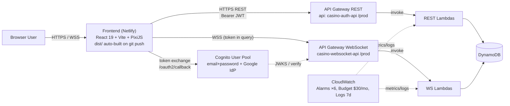
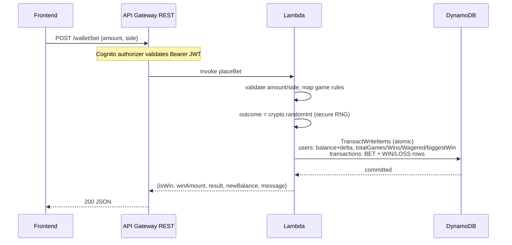
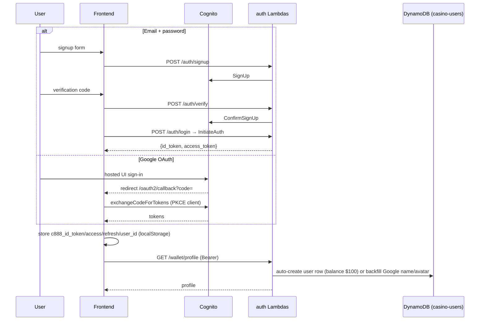
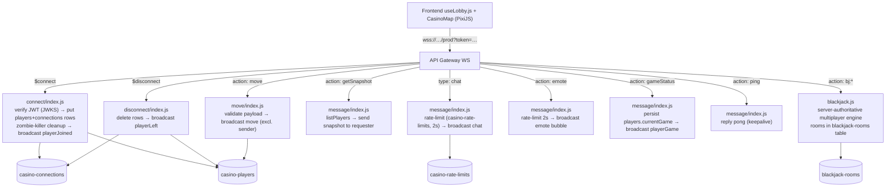
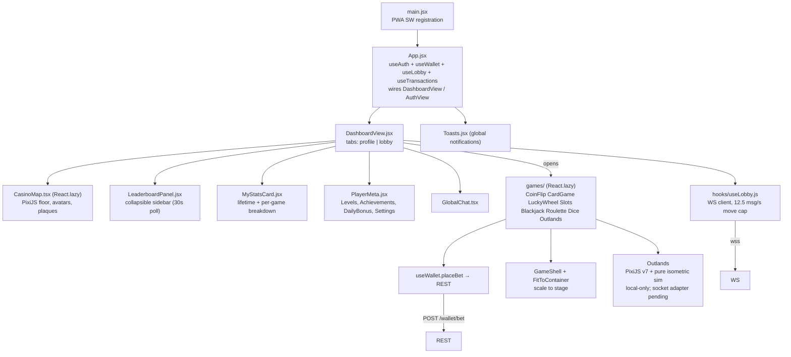
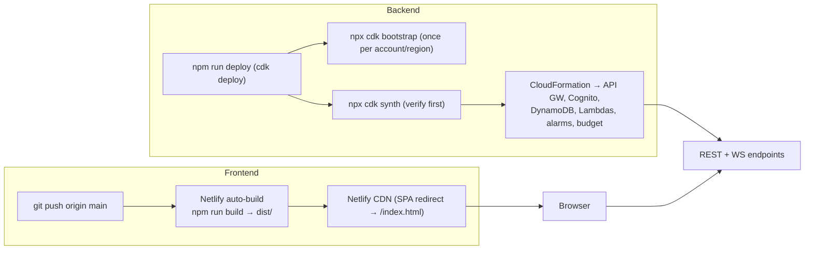

# ReimonDev Games — System Architecture

A play-money game library with a casino mini-game. React/Vite frontend on Netlify, serverless AWS backend (Cognito + API Gateway + DynamoDB + Lambda) deployed via CDK.

Status: **LIVE (demo / play-money only)**. Authority docs: `PROJECT_DESIGN.md` (product), `lib/casino-infra-stack.ts` (infra source of truth).

Diagrams use Mermaid — render in GitHub/VS Code, and parse programmatically.

---

## 1. System Context



---

## 2. REST API (server-authoritative backend)

| Area | Route | Lambda | Auth |
|------|-------|--------|------|
| Auth | `POST /auth/signup`, `/verify`, `/login`, `/forgot`, `/confirm-forgot-password` | `lambdas/{signup,verify,login,forgot,confirm-forgot}` | public |
| Auth | `POST /auth/delete-account` | `lambdas/delete-account` | Cognito authorizer |
| Wallet | `GET/POST /wallet/profile` | `lambdas/getUserProfile` (GET=read own/`?userId=` public profile, POST=update nickname/avatar) | Cognito authorizer |
| Wallet | `GET /wallet/transactions` | `lambdas/getTransactionHistory` | Cognito |
| Wallet | `POST /wallet/deposit` · `/withdraw` · `/bet` | `lambdas/depositFunds` · `withdrawFunds` · `placeBet` | Cognito |
| Lobby | `GET /players/status` | `lambdas/players/status` | Cognito |
| Games | `GET /games/leaderboard` | `lambdas/games/leaderboard` | **public** |



Key rules: every balance change is one atomic `TransactWriteItems` (users table + 2 transaction rows) → no race conditions, immutable audit trail. Outcomes are decided **server-side only**; the client animates the server result.

---

## 3. Auth Flow



- WS identity is **server-authoritative**: `connect` verifies the JWT signature via cached JWKS (1h TTL) and takes identity only from verified claims + the users table — query-param `nickname` is a fallback, never authority.

---

## 4. WebSocket Lobby + Chat + Blackjack



Chat and emotes ride the **same** WebSocket API as lobby presence — there is a single WS API (`casino-websocket-api`), not two. All WS lambdas share one bundle (`lambdas/websocket/` → `utils.js`, `blackjack.js`).

---

## 5. Data Model (DynamoDB)

All tables are **pay-per-request** (on-demand). Removal policies: `casino-users`, `casino-transactions`, `blackjack-rooms` = **RETAIN**; `casino-players`, `casino-connections`, `casino-rate-limits` = DESTROY + **TTL**.

```mermaid
erDiagram
    casino-users ||--o{ casino-transactions : "1 user → many txs"
    casino-users ||--o{ casino-connections : "1 user → WS connections"
    casino-users ||--o{ casino-players : "1 user → lobby presence"
    casino-users ||--o{ casino-rate-limits : "throttle keys"

    casino-users {
        string userId PK
        string email
        number currentBalance
        string nickname
        string avatarImage
        number totalGames totalWins totalWagered totalWon biggestWin
        string createdAt updatedAt
    }
    casino-transactions {
        string userId PK
        number timestamp SK
        string transactionId
        string type "BET | WIN | LOSS | DEPOSIT | WITHDRAW"
        number amount
        string gameName
        string gameDetails
        number balanceAfter
        string createdAt
    }
    casino-players {
        string connectionId PK
        string roomId SK
        string userId "GSI: userIdIndex"
        string playerId nickname
        number avatarSize direction
        string avatarColor avatarImage currentGame status
        object position
        number ttl "expires +1h"
    }
    casino-connections {
        string connectionId PK
        string userId
        number ttl
    }
    blackjack-rooms {
        string roomId PK
        object state
        number ttl
    }
    casino-rate-limits {
        string key PK
        number ttl
    }
```

---

## 6. Frontend Structure



- Styling: Tailwind v4 (no config) — custom tokens in `App.css` `@theme` block; hand-written CSS in `App.css` (~2.1k lines).
- **Outlands** is a lazy-loaded browser game at `/outlands`: infinite procedural chunks, 3×3 named sectors/outposts, survival/progression/inventory, seven weapon classes, nine zombie variants, loot containers, interiors, dynamic lighting, gore decals, and sprite assets. The active game UI still uses local simulation and localStorage stash. `server/outlands/` contains a separate Cognito-authenticated WebSocket room-service prototype; it is not deployed by CDK or yet wired to the expanded RPG UI. Its room state is process-memory-only and the server-side stash resets after reconnect grace expires.
- Endpoints: `frontend/src/utils/api.js` `API_BASE` (defaults to prod, overridable `VITE_API_URL`); `useLobby.js` WS URL (`VITE_WEBSOCKET_URL`). See `frontend/.env.example`.

---

## 7. Deployment Pipeline



**Two independent deploys.** Frontend: Netlify auto-build on push. Backend: manual `npm run deploy`. After changing the stack, update the hardcoded URLs in `api.js` / `useLobby.js` (or `.env`) — otherwise the frontend keeps hitting stale prod endpoints.

Cost guardrails baked into the stack: budget `casino888-dev-budget` ($30/mo, email alerts at 50/80/100% when `budgetEmail` set), CloudWatch error alarms on 6 key lambdas, `logRetention: ONE_WEEK`, REST stage throttling 20 rps / burst 10, **no** `reservedConcurrentExecutions` (account concurrency limit is 10).

---

## 8. Quality Gates & Verification

| Command | Purpose |
|---------|---------|
| `npm run dev` | Vite dev server (port 3000) → hits deployed prod API |
| `npm run lint` | ESLint flat config, errors-only (`--quiet`) |
| `npm run typecheck` | `tsc --noEmit -p frontend/tsconfig.json` (strict) — catches blank-screen reference errors |
| `npm run build` | Vite production build → `dist/` (de-facto frontend verification) |
| `npx tsc --noEmit` | CDK TypeScript (root `tsconfig.json`, `bin/`+`lib/`) |
| `npx cdk synth` | Validate the CloudFormation template before deploying |
| `node lambdas/websocket/blackjack.test.js` | Blackjack engine self-test (only test in repo) |

Per `PROJECT_DESIGN.md`: any change touching auth, wallet, game outcomes, infrastructure, or shared state requires analysis before implementation, verification commands, and documented risks.

---

## 9. Known Architecture Notes / Gotchas

- **Lambda bundling**: CDK zips `lambdas/<dir>` as-is. Node 20 runtime does **not** ship AWS SDK v3, so each lambda folder needs its own committed `package.json` + installed `node_modules` before `cdk deploy`.
- **CDK typos that break synth**: Lambda prop is `reservedConcurrentExecutions` (not `reservedConcurrency`); REST throttling lives on the `RestApi` `deployOptions` (not `MethodOptions`); tag prop is `resourceTags` (not `tags`).
- **Blackjack** is the only multiplayer game: server-authoritative state in `lambdas/websocket/blackjack.js`, rooms persisted in `blackjack-rooms`, multi-handler WS lambdas share `lambdas/websocket/utils.js`.
- **Deletion**: `delete-account` removes the Cognito user + all rows (users, transactions, players, connections) — mirrors the tables it has grants on.
- **Security baseline done**: WS JWT signature verification (cached JWKS), server-authoritative identity, atomic wallet writes, `crypto.randomInt` for all game outcomes + blackjack shuffle. Not done: automated CI, unit-test suite beyond the blackjack self-test, moving committed OAuth secret in `cdk.json` to env/SSM.
